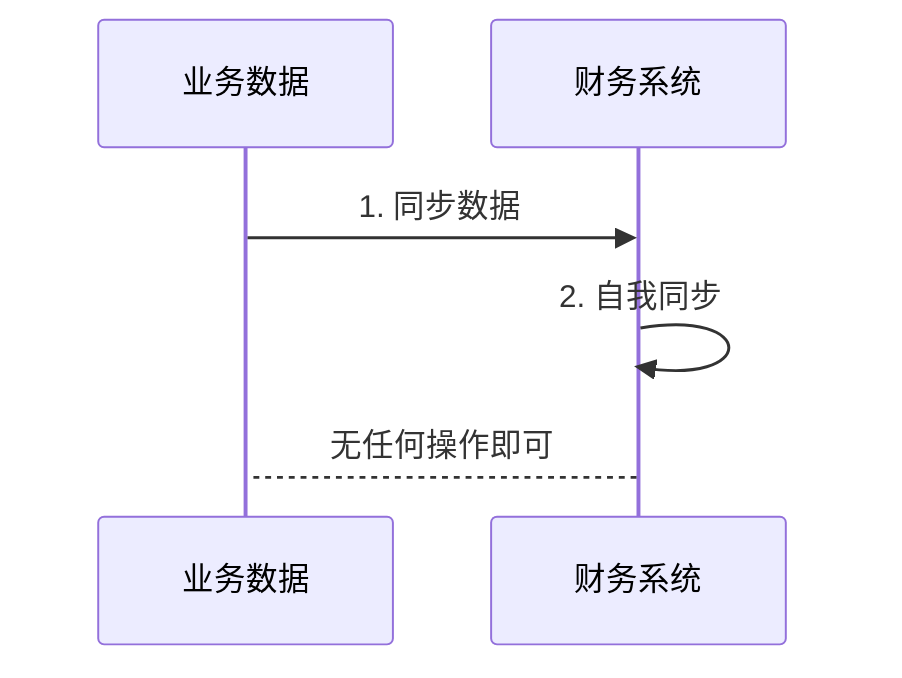

# 为什么决定在这里写?

写着写着这个博客渐渐的变成了一些自述，因为好像没有什么技术可以值得分享的。

想着能不能把每天做的东西在这里做一个陈述，然后利用AI工具帮我做出一些分析，能看出最近的思考轨迹，做出下一步的自我优化的点。

# 最近做的财务系统的心得

最近做的财务的对账系统，感觉怎么说，平平无奇吧，就是一些`sync`的逻辑。

这种逻辑可以分为三层

- **同步数据**，将数据从业务系统中同步到财务系统中来
- **数据模型**，财务系统往往更加关心一个数据的组成部分，一个最终的金额并不是最终的期望
- **生成法则**，一个账单的生成法则并不是很简单，需要考虑如果有退款单的时候需要删除，还是需要更新，还是需要仅生成，而不作用于任何账单



# 一些难点

写这个系统的过程中，有可能无意识的就可能把这个系统写成一个时间复杂度极高的一个系统

写这个系统的过程中，就会写出下面这样的代码

```java
var billsFromDB = new HashMap<>();
for (Bill bill : bills) {
	if (biilsFromDB.contains(bill.getID())) {
        this.updateExistBills(bill); // 更新
    } else {
        var billTerm = this.inferBillTerm(bill);
        if (this.isPeriodBillExists(billTerm)) { // 推断一批的账单
            // 新增
            // 计算
        }
    }
}
```

这种逻辑会特别的复杂，在写的过程中可能就需要不断的优化，这些时间复杂度。

此外，关于这个系统，最后尝试做了一次跑批，大概是**40万的数据量**，非常不幸在一个2核4G的机器上跑崩了，CPU的利用率达到了**95%**。

- 代码上的还需要有一些优化点
- 关于循环查库还有待优化的
